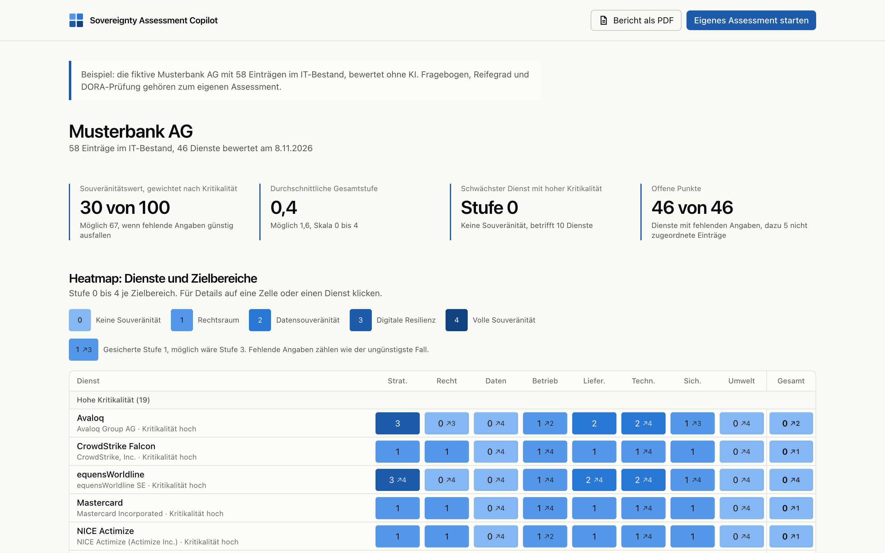
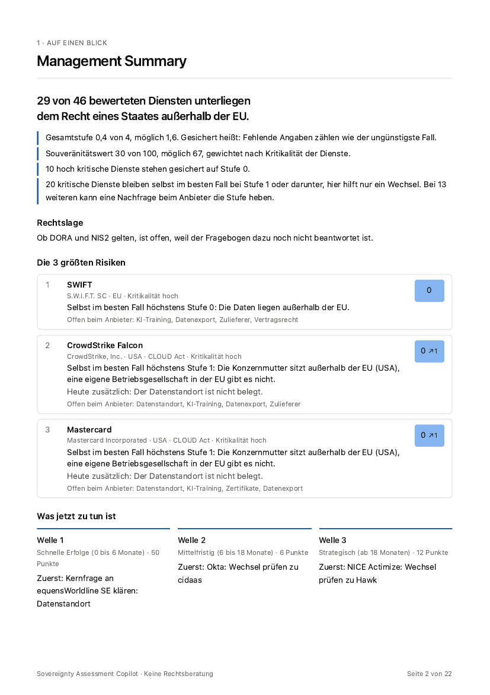
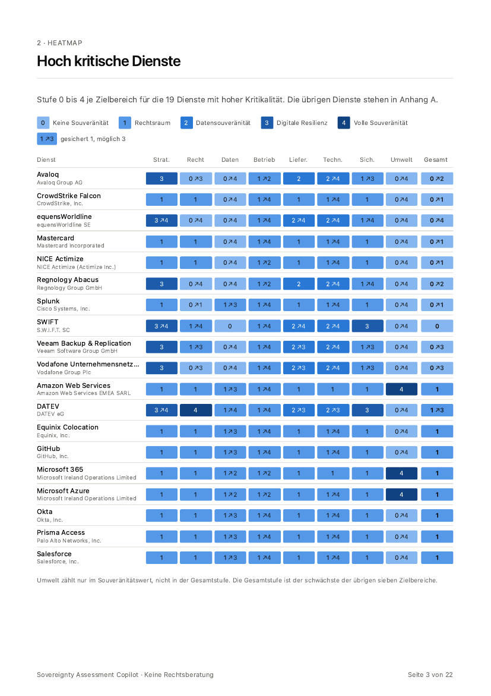
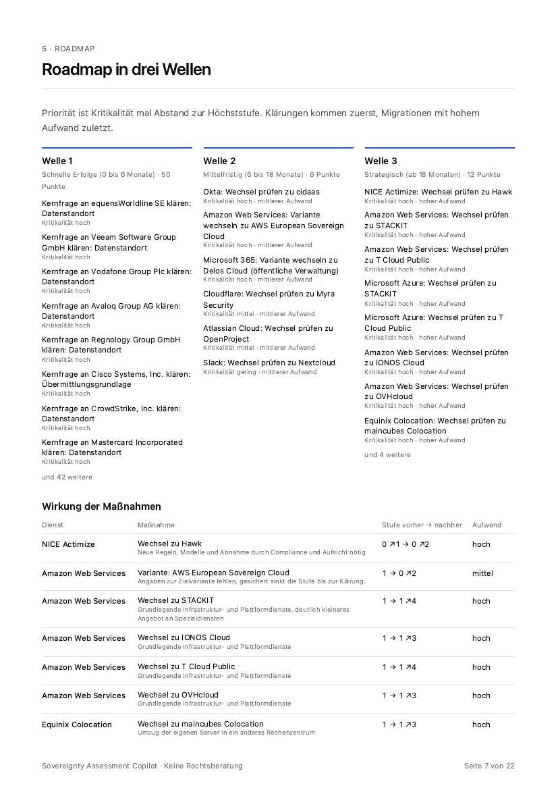
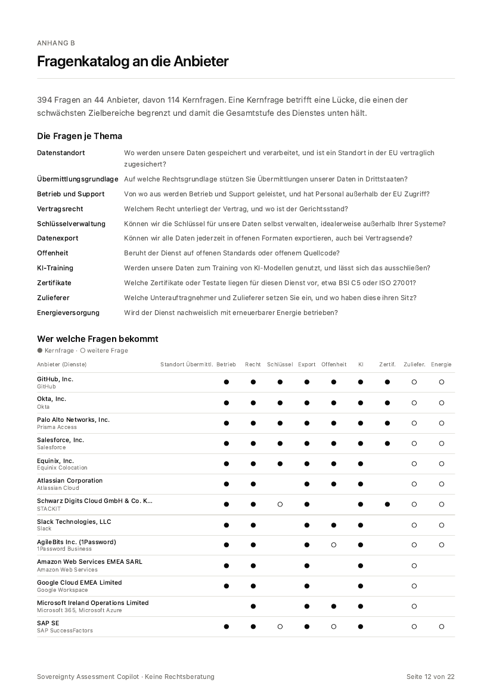
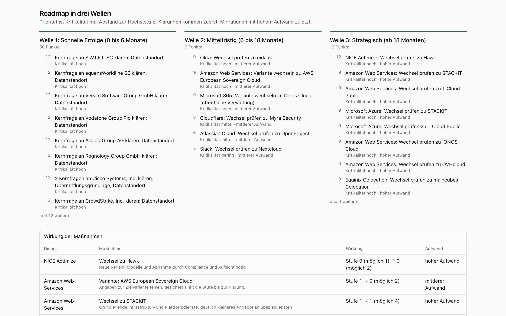
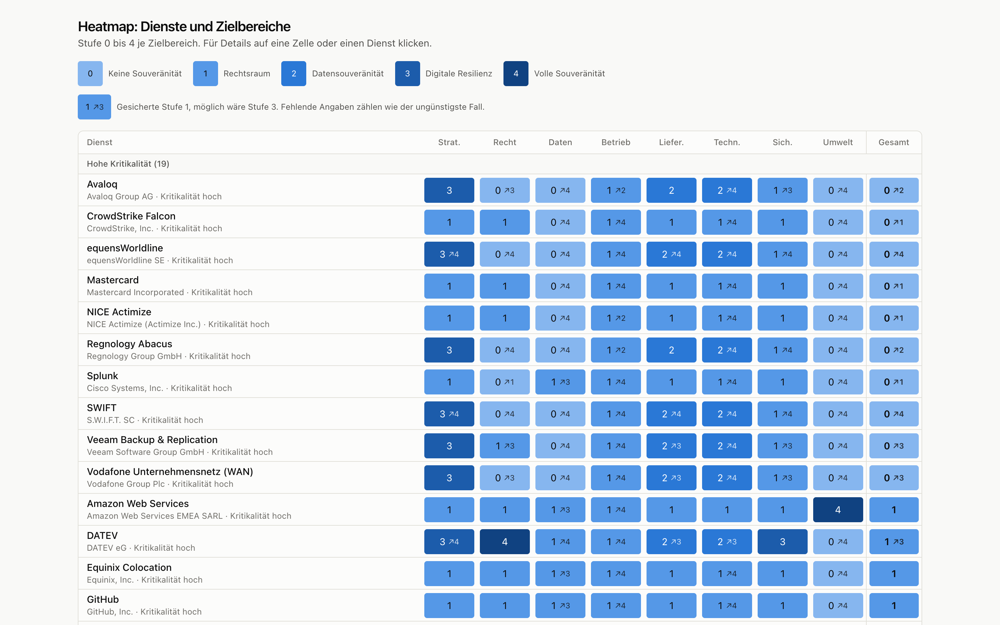

# Sovereignty Assessment Copilot

**Wie abhängig ist ein Unternehmen von IT-Anbietern außerhalb der EU, und was sollte es zuerst ändern?**

Der Copilot bewertet das nach dem EU Cloud Sovereignty Framework (v1.2.1), prüft DORA und NIS2 und leitet eine Roadmap in drei Wellen ab. Jede Aussage hat eine Quelle. Das Projekt ist eine automatisierte Variante eines mehrwöchigen Digital-Sovereignty-Assessments, wie es Beratungen anbieten.



**[Beispielbericht als PDF ansehen](docs/beispielbericht-musterbank.pdf)**: 22 Seiten für die fiktive Musterbank AG, mit Management Summary, Heatmap, Risiken, Rechtslage, Roadmap, Methodik, Fragenkatalog und Quellen.

## Was das Tool kann

| Stufe | Eingabe | Ergebnis | Stand |
|---|---|---|---|
| **1. Schnellcheck** | nur die Website | Dienste aus E-Mail, DNS, Hosting und Website, Unternehmensprofil aus Impressum und GLEIF, Gesamtstufe, größte Hebel | ✅ fertig |
| **2. Assessment** | Fragebogen und IT-Bestand (Excel/CSV) | Heatmap Dienste × Zielbereiche, DORA/NIS2-Vorprüfung, Reifegrad, Roadmap, Fragenkatalog an die Anbieter, Bericht als PDF | ✅ fertig |
| **3. Tiefenprüfung** | Verträge als PDF | KI-Vertragsanalyse mit Seitenangabe, Entwurf des DORA-Informationsregisters, Workshop-Präsentation | in Arbeit: Hochladen, Einordnen und Auslesen mit Belegprüfung laufen über die API, Prüfansicht folgt. Ablauf festgelegt in der [Arbeitsanweisung](docs/tiefenpruefung-ablauf.md) |

Der Schnellcheck sieht nur, was ein Unternehmen nach außen zeigt. Die kritischen Abhängigkeiten liegen meist dahinter, etwa Kernbanksystem, Backup oder Verträge. Deshalb führt er direkt ins Assessment. Die erkannten Dienste werden zum Startbestand, Branche und Größe schlägt die KI mit wörtlichem Zitat von der Website vor.

## Beispiel: der Bericht für die Musterbank AG

Die Musterbank AG ist erfunden: eine kleine Bank mit 58 Einträgen im IT-Bestand, vom Kernbanksystem über Zahlungsverkehr und Meldewesen bis zu Büro-Software. 46 davon erkennt das Tool und bewertet sie, die übrigen meldet es als nicht zugeordnet. Das Ergebnis in Kürze:

- **29 von 46 Diensten** unterliegen dem Recht eines Staates außerhalb der EU.
- **Souveränitätswert 30 von 100**, möglich wären 67, wenn alle fehlenden Angaben günstig ausfallen.
- **10 hoch kritische Dienste** stehen gesichert auf Stufe 0, bei 20 kritischen hilft selbst im besten Fall nur ein Wechsel.
- **394 Fragen an 44 Anbieter**, davon 114 Kernfragen, die die Gesamtstufe eines Dienstes unten halten.

| Management Summary | Heatmap der hoch kritischen Dienste |
|---|---|
| [](docs/beispielbericht-musterbank.pdf) | [](docs/beispielbericht-musterbank.pdf) |
| **Roadmap in drei Wellen** | **Fragenkatalog an die Anbieter** |
| [](docs/beispielbericht-musterbank.pdf) | [](docs/beispielbericht-musterbank.pdf) |

Im Tool selbst liegt die Musterbank unter `/beispiel`, der Bericht unter `/beispiel/bericht`.

## Beispiele aus der Bewertung

Vier Dienste der Musterbank zeigen, wie unterschiedlich die Gründe für eine niedrige Stufe sind. Die Zahl vor dem Pfeil ist die gesicherte Stufe, die dahinter die beste mögliche, wenn alle offenen Angaben günstig ausfallen.

| Dienst | Stufe | Warum | Was das Tool vorschlägt |
|---|---|---|---|
| **Microsoft 365** | 1 | Die Konzernmutter sitzt in den USA (CLOUD Act). Daran ändert auch ein Rechenzentrum in der EU nichts, deshalb bleibt es selbst im besten Fall bei Stufe 1. | Wechsel zur Variante Delos Cloud (mittlerer Aufwand) oder zu Nextcloud (hoher Aufwand, möglich dann Stufe 3) |
| **SWIFT** | 0 | Ein Anbieter mit Sitz in Belgien, aber Zahlungen in die transatlantische Zone werden laut SWIFT auch im Rechenzentrum in den USA gespeichert. | Keine Alternative in der Datenbank. Der Bericht führt SWIFT als größtes strukturelles Risiko, das sich durch Nachfragen nicht beheben lässt |
| **SCHUFA-Auskunft** | 0 ↗4 | Ein deutscher Anbieter, der aber weder Datenstandort noch Zertifikate veröffentlicht. Fehlende Angaben zählen wie der ungünstigste Fall. | Zehn Fragen an die SCHUFA Holding AG, zuerst die Kernfrage nach dem Datenstandort |
| **SAP SuccessFactors** | 1 ↗3 | Testat nach BSI C5 und Rechenzentren in Frankfurt und Walldorf wählbar. Offen sind Vertragsrecht, Betriebsort und Datenexport. | Fragen an den Anbieter, kein Wechsel nötig |

Jeder Wert in der Tabelle geht auf eine Fundstelle zurück, etwa für SWIFT:

> „The messages sent by a customer from the European messaging Zone will only be processed and stored in the Swift US OPC if the recipient customer is from the Trans-Atlantic messaging Zone.“
> [swift.com, Data Protection FAQ](https://www.swift.com/about-us/legal/compliance/data-protection-policies/frequently-asked-questions)

So sieht eine Frage aus dem Fragenkatalog aus:

> **Kernfrage an SCHUFA Holding AG, Datenstandort:** Wo werden unsere Daten gespeichert und verarbeitet, und ist ein Standort in der EU vertraglich zugesichert?



## Methodik in Kürze

- **Acht Zielbereiche** des EU-Rahmenwerks: strategisch, rechtlich, Daten und KI, operativ, Lieferkette, Technologie, Sicherheit und Compliance, Umwelt.
- **Stufe 0 bis 4 je Dienst und Zielbereich** (SEAL). Die Gesamtstufe eines Dienstes ist die schwächste der sieben Bereiche ohne Umwelt. Umwelt zählt nur im Souveränitätswert von 0 bis 100.
- **Maßgeblich ist der Rechtsraum des Mutterkonzerns**, nicht der Serverstandort. Ein US-Konzern bleibt über den CLOUD Act erreichbar, auch mit Rechenzentrum in Frankfurt.
- **Fehlende Angaben zählen wie der ungünstigste Fall.** Das Tool zeigt die gesicherte und die mögliche Stufe („1 ↗3“). Was fehlt, landet im Fragenkatalog an den Anbieter.
- **Priorisierung:** Kritikalität mal Abstand zur Höchststufe. Klärungen kommen zuerst, Migrationen mit hohem Aufwand zuletzt.

Details: [Bewertungslogik](docs/bewertungslogik.md) · [Datenmodell](docs/datenmodell.md)



## Belege statt Behauptungen

Jede Angabe in der Anbieterdatenbank hat eine Quelle mit wörtlicher Fundstelle. Ein Skript ruft alle Quellen erneut ab und prüft, ob die Fundstelle dort noch steht. Ist eine Seite gesperrt oder umgebaut, prüft es die jüngste Kopie im Internet Archive. Stand 8. November 2026: **244 Fundstellen direkt bestätigt, 9 über das Internet Archive, 4 von einem Menschen im Browser.** Eine Fundstelle im Außenscan, die Einbauanleitung für das Google-Tag, steht so nicht mehr auf der Seite und wird überarbeitet. Auch DORA und NIS2 sind mit Artikel und Absatz aus dem amtlichen Text belegt.

Das Skript findet auch echte Änderungen: Als Google im Oktober 2026 seine Seite zu Netto-Null umbaute, fiel die Fundstelle zu erneuerbarer Energie weg. Die Angabe stützt sich seitdem auf den Umweltbericht 2026.

Jeder Dienst trägt einen Prüfstatus: Vorschläge der KI prüft die KI in einem zweiten Durchgang an den Quellen nach (`KI_NACHGEPRUEFT`), eine Bestätigung durch einen Menschen (`GEPRUEFT`) ist zusätzlich möglich. Was sich nicht belegen lässt, wird nicht eingetragen: Ein Testat von 2019 belegt keinen heutigen Stand, eine Herstelleraussage wie „erfüllt die Anforderungen von C5“ ist kein Testat. Solche Lücken landen im Fragenkatalog.

Bei der Erkennung im Außenscan gibt es Belegstufen:

1. **Merkmal mit Herstellerquelle**, automatisch geprüft, direkt oder über das Internet Archive
2. **Von einem Menschen geprüft**, wenn kein automatischer Weg zur Herstellerseite führt
3. **Signatur** aus einer offenen Liste: Das Werkzeug hat dann einen Namen, wird aber nicht bewertet, weil die Liste nicht sagt, wem es gehört

Vorschläge der KI zu Branche und Größe gelten erst nach Bestätigung durch einen Menschen. Ein Vorschlag ohne wörtlich nachprüfbares Zitat wird verworfen.

## Abgrenzung zu kostenlosen Website-Scannern

Scanner wie [scan.meetergo.com](https://scan.meetergo.com) prüfen von außen nur die Website. Der Copilot ergänzt das:

- **Von innen:** IT-Bestand, Fragebogen und später Verträge, also auch Systeme ohne Spur auf der Website
- **Tiefer im Außenscan:** E-Mail-Absender im SPF-Eintrag und Netzbetreiber. So findet er etwa ein Ticketsystem, das E-Mails im Namen der Firma verschickt, oder das Rechenzentrum, in dem die Website steht.
- **Nach Rahmenwerk statt Schulnote:** Stufen nach dem EU Cloud Sovereignty Framework, Rechtsraum des Mutterkonzerns, Hinweise zu DORA und NIS2
- **Mit belegten Alternativen:** EU-Alternativen mit grobem Aufwand, oder ein Variantenwechsel beim selben Anbieter

## Technik

| Bereich | Umsetzung |
|---|---|
| Backend | Python 3.13, FastAPI, SQLAlchemy 2, Alembic, PostgreSQL 17 |
| Oberfläche | Next.js 16, React 19, Tailwind CSS 4, hell und dunkel, nutzbar auf dem Handy |
| Außenscan | dnspython, RIPEstat (Netzbetreiber), GLEIF (LEI und Konzernmutter), abgesicherter Abruf gegen SSRF, Fortschritt per Server-Sent Events |
| KI | austauschbares Modul über OpenRouter, nur Anbieter ohne Datenspeicherung, Gesamtfrist je Anfrage |
| Daten | YAML je Dienst in [`data/`](data/README.md): 82 Dienste, 80 Unternehmen, 4 Zertifikate und Testate, 27 Fragen, Testdaten der fiktiven Musterbank AG |
| Qualität | 622 Tests mit pytest, ruff, TypeScript strict, ESLint, Prüfskript für alle Fundstellen |

```
frontend/   Next.js-Oberfläche
backend/    FastAPI: scan/ (Außenscan), scoring/ (Stufen), compliance/ (DORA, NIS2),
            roadmap/, questionnaire/, inventory/ (Import und Zuordnung), matching/ (KI), report/
data/       Anbieterdatenbank, Fragebogen, Erkennungsmerkmale, Testdaten
docs/       Bewertungslogik, Datenmodell, Beispielbericht, Screenshots
```

## Lokal starten

Voraussetzungen: Docker, [uv](https://docs.astral.sh/uv/) und Node.js 22.

```bash
cp .env.example .env              # eigenes Datenbank-Passwort eintragen, KI-Schlüssel optional
docker compose up -d              # PostgreSQL

cd backend
uv sync
uv run alembic upgrade head       # Tabellen anlegen
uv run python -m app.seed         # Anbieterdatenbank laden
uv run uvicorn app.main:app --reload

cd ../frontend                    # in einem zweiten Terminal
npm install
npm run dev                       # http://localhost:3000
```

Ohne KI-Schlüssel läuft alles, nur ohne Vorschläge für Branche und Größe und ohne KI-Rückfall bei der Zuordnung des IT-Bestands. Zum Ausprobieren ohne eigene Daten gibt es die Musterbank unter `/beispiel`, ihren Bericht unter `/beispiel/bericht`.

Weitere Befehle im Ordner `backend/`:

```bash
uv run pytest                               # Tests
uv run python scripts/verify_evidence.py    # alle Fundstellen erneut prüfen
```

## Grenzen

- **Keine Rechtsberatung.** Die Vorprüfung zu DORA und NIS2 zeigt die Fundstellen, ersetzt aber keine rechtliche Prüfung.
- **Die Datenbank ist im Aufbau.** Viele Anbieter veröffentlichen Datenstandort oder Schlüsselverwaltung nicht, gerade spezialisierte Finanzdienstleister. Solche Lücken senken die gesicherte Stufe und landen im Fragenkatalog.
- **Der Außenscan sieht nur Öffentliches.** Seiten mit Bot-Schutz lassen sich teilweise nicht laden, das Tool meldet das und umgeht den Schutz nicht.
- **KI für echte Kundendaten:** Für den Einsatz mit echten Verträgen ist ein in der EU betriebenes Modell vorgesehen.

## Stand und nächste Schritte

- [x] Anbieterdatenbank, IT-Bestand mit Import und Zuordnung, Außenscan, Fragebogen, Bewertung, Roadmap, Oberfläche
- [x] PDF-Bericht: Management Summary, Heatmap, Risiken (strukturell oder Klärungsbedarf), Rechtslage, Roadmap, Methodik und Grenzen, Fragenkatalog und Quellenverzeichnis
- [x] Alle Dienste der Musterbank an den Quellen nachgeprüft
- [ ] Ausbau der Datenbank auf rund 150 häufige Unternehmensdienste
- [ ] Stufe 3: Vertragsanalyse, DORA-Informationsregister, Workshop-Präsentation
- [ ] Online-Demo

Der vollständige Plan steht in [PLAN.md](PLAN.md).

## Daten Dritter

Die Signaturliste in [`data/signatures/`](data/signatures/) stammt aus [enthec/webappanalyzer](https://github.com/enthec/webappanalyzer) und steht unter GPL-3.0. Die Gesetzestexte stammen aus EUR-Lex, die Unternehmensdaten aus GLEIF und RIPEstat.
