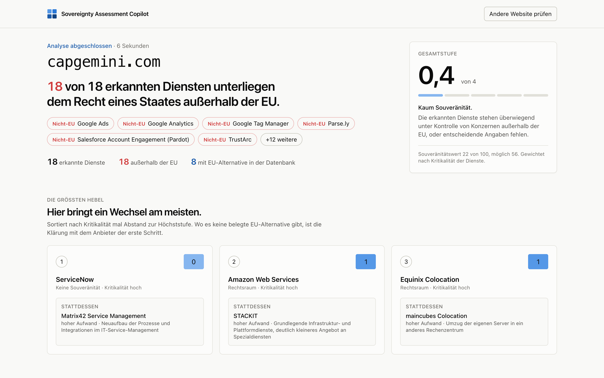
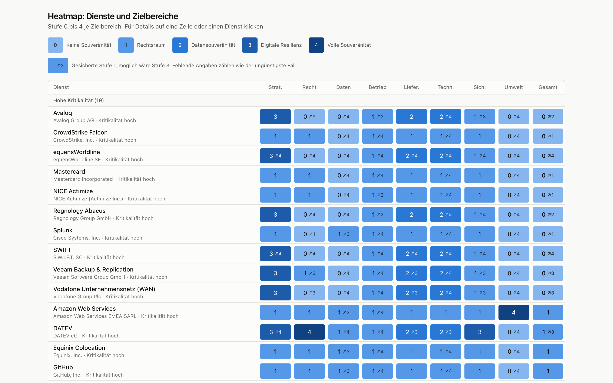
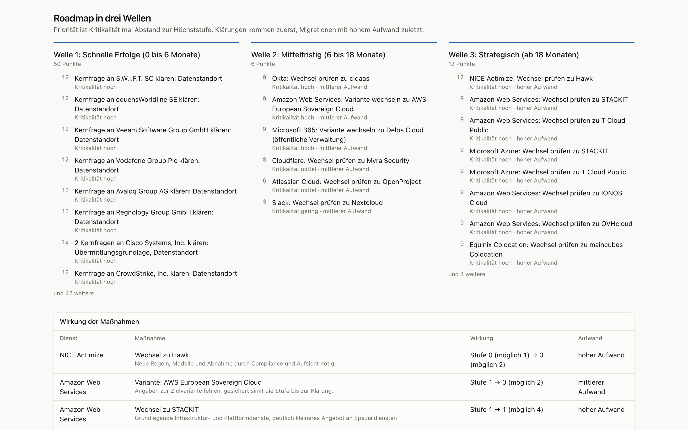

# Sovereignty Assessment Copilot

**Wie abhängig ist ein Unternehmen von IT-Anbietern außerhalb der EU, und was sollte es zuerst ändern?**

Der Copilot bewertet das nach dem EU Cloud Sovereignty Framework (v1.2.1), prüft DORA und NIS2 und leitet eine Roadmap in drei Wellen ab. Jede Aussage hat eine Quelle. Das Projekt ist eine automatisierte Variante eines mehrwöchigen Digital-Sovereignty-Assessments, wie es Beratungen anbieten.



## Was das Tool kann

| Stufe | Eingabe | Ergebnis | Stand |
|---|---|---|---|
| **1. Schnellcheck** | nur die Website | Dienste aus E-Mail, DNS, Hosting und Website, Unternehmensprofil aus Impressum und GLEIF, Gesamtstufe, größte Hebel | ✅ fertig |
| **2. Assessment** | Fragebogen und IT-Bestand (Excel/CSV) | Heatmap Dienste × Zielbereiche, DORA/NIS2-Vorprüfung, Reifegrad, Roadmap, Fragenkatalog an die Anbieter | ✅ fertig |
| **3. Tiefenprüfung** | Verträge als PDF | KI-Vertragsanalyse mit Seitenangabe, Entwurf des DORA-Informationsregisters, Workshop-Präsentation | geplant |

Der Schnellcheck sieht nur, was ein Unternehmen nach außen zeigt. Die kritischen Abhängigkeiten liegen meist dahinter, etwa Kernbanksystem, Backup oder Verträge. Deshalb führt er direkt ins Assessment. Die erkannten Dienste werden zum Startbestand, Branche und Größe schlägt die KI mit wörtlichem Zitat von der Website vor.



## Methodik in Kürze

- **Acht Zielbereiche** des EU-Rahmenwerks: strategisch, rechtlich, Daten und KI, operativ, Lieferkette, Technologie, Sicherheit und Compliance, Umwelt.
- **Stufe 0 bis 4 je Dienst und Zielbereich** (SEAL). Die Gesamtstufe eines Dienstes ist die schwächste der sieben Bereiche ohne Umwelt. Umwelt zählt nur im Souveränitätswert von 0 bis 100.
- **Maßgeblich ist der Rechtsraum des Mutterkonzerns**, nicht der Serverstandort. Ein US-Konzern bleibt über den CLOUD Act erreichbar, auch mit Rechenzentrum in Frankfurt.
- **Fehlende Angaben zählen wie der ungünstigste Fall.** Das Tool zeigt die gesicherte und die mögliche Stufe („1 ↗3“). Was fehlt, landet im Fragenkatalog an den Anbieter.
- **Priorisierung:** Kritikalität mal Abstand zur Höchststufe. Klärungen kommen zuerst, Migrationen mit hohem Aufwand zuletzt.

Details: [Bewertungslogik](docs/bewertungslogik.md) · [Datenmodell](docs/datenmodell.md)



## Belege statt Behauptungen

Jede Angabe in der Anbieterdatenbank hat eine Quelle mit wörtlicher Fundstelle. Ein Skript ruft alle Quellen erneut ab und prüft, ob die Fundstelle dort noch steht. Stand heute sind es **230 automatisch bestätigte Fundstellen und 8 von einem Menschen bestätigte**, bei 0 Problemen. Auch DORA und NIS2 sind mit Artikel und Absatz aus dem amtlichen Text belegt.

Bei der Erkennung im Außenscan gibt es Belegstufen:

1. **Merkmal mit Herstellerquelle**, automatisch geprüft
2. **Von einem Menschen geprüft**, wenn die Herstellerseite automatische Abrufe sperrt
3. **Signatur** aus einer offenen Liste: Das Werkzeug hat dann einen Namen, wird aber nicht bewertet, weil die Liste nicht sagt, wem es gehört

KI-Vorschläge gelten erst nach Bestätigung durch einen Menschen. Ein Vorschlag ohne wörtlich nachprüfbares Zitat wird verworfen.

## Abgrenzung zu kostenlosen Website-Scannern

Scanner wie [scan.meetergo.com](https://scan.meetergo.com) prüfen von außen nur die Website. Der Copilot ergänzt das:

- **Von innen:** IT-Bestand, Fragebogen und später Verträge, also auch Systeme ohne Spur auf der Website
- **Tiefer im Außenscan:** E-Mail-Absender im SPF-Eintrag und Netzbetreiber. Bei capgemini.com findet er so zum Beispiel ServiceNow, Azure, Equinix und Rackspace.
- **Nach Rahmenwerk statt Schulnote:** Stufen nach dem EU Cloud Sovereignty Framework, Rechtsraum des Mutterkonzerns, Hinweise zu DORA und NIS2
- **Mit belegten Alternativen:** EU-Alternativen mit grobem Aufwand, oder ein Variantenwechsel beim selben Anbieter

## Technik

| Bereich | Umsetzung |
|---|---|
| Backend | Python 3.13, FastAPI, SQLAlchemy 2, Alembic, PostgreSQL 17 |
| Oberfläche | Next.js 16, React 19, Tailwind CSS 4, hell und dunkel, nutzbar auf dem Handy |
| Außenscan | dnspython, RIPEstat (Netzbetreiber), GLEIF (LEI und Konzernmutter), abgesicherter Abruf gegen SSRF, Fortschritt per Server-Sent Events |
| KI | austauschbares Modul über OpenRouter, nur Anbieter ohne Datenspeicherung, Gesamtfrist je Anfrage |
| Daten | YAML je Dienst in [`data/`](data/README.md): 82 Dienste, 79 Unternehmen, 27 Fragen, Testdaten einer fiktiven Musterbank AG |
| Qualität | 505 Tests mit pytest, ruff, TypeScript strict, ESLint, Prüfskript für alle Fundstellen |

```
frontend/   Next.js-Oberfläche
backend/    FastAPI: scan/ (Außenscan), scoring/ (Stufen), compliance/ (DORA, NIS2),
            roadmap/, questionnaire/, inventory/ (Import und Zuordnung), matching/ (KI)
data/       Anbieterdatenbank, Fragebogen, Erkennungsmerkmale, Testdaten
docs/       Bewertungslogik, Datenmodell, Screenshots
```

## Lokal starten

Voraussetzungen: Docker, [uv](https://docs.astral.sh/uv/) und Node.js 22.

```bash
cp .env.example .env              # eigenes Datenbank-Passwort eintragen, KI-Schlüssel optional
docker compose up -d              # PostgreSQL

cd backend
uv sync
uv run alembic upgrade head       # Tabellen anlegen
uv run python -m app.seed         # Anbieterdatenbank laden
uv run uvicorn app.main:app --reload

cd ../frontend                    # in einem zweiten Terminal
npm install
npm run dev                       # http://localhost:3000
```

Ohne KI-Schlüssel läuft alles, nur ohne Vorschläge für Branche und Größe und ohne KI-Rückfall bei der Zuordnung des IT-Bestands. Zum Ausprobieren ohne eigene Daten gibt es die Musterbank unter `/beispiel`.

Weitere Befehle im Ordner `backend/`:

```bash
uv run pytest                               # Tests
uv run python scripts/verify_evidence.py    # alle Fundstellen erneut prüfen
```

## Grenzen

- **Keine Rechtsberatung.** Die Vorprüfung zu DORA und NIS2 zeigt die Fundstellen, ersetzt aber keine rechtliche Prüfung.
- **Die Datenbank ist im Aufbau.** Viele Anbieter veröffentlichen Datenstandort oder Schlüsselverwaltung nicht. Solche Lücken senken die gesicherte Stufe und landen im Fragenkatalog.
- **Der Außenscan sieht nur Öffentliches.** Seiten mit Bot-Schutz lassen sich teilweise nicht laden, das Tool meldet das.
- **KI für echte Kundendaten:** Für den Einsatz mit echten Verträgen ist ein in der EU betriebenes Modell vorgesehen.

## Stand und nächste Schritte

- [x] Anbieterdatenbank, IT-Bestand mit Import und Zuordnung, Außenscan, Fragebogen, Bewertung, Roadmap, Oberfläche
- [ ] PDF-Bericht
- [ ] Ausbau der Datenbank auf rund 150 häufige Unternehmensdienste
- [ ] Stufe 3: Vertragsanalyse, DORA-Informationsregister, Workshop-Präsentation
- [ ] Online-Demo

Der vollständige Plan steht in [PLAN.md](PLAN.md).

## Daten Dritter

Die Signaturliste in [`data/signatures/`](data/signatures/) stammt aus [enthec/webappanalyzer](https://github.com/enthec/webappanalyzer) und steht unter GPL-3.0. Die Gesetzestexte stammen aus EUR-Lex, die Unternehmensdaten aus GLEIF und RIPEstat.
