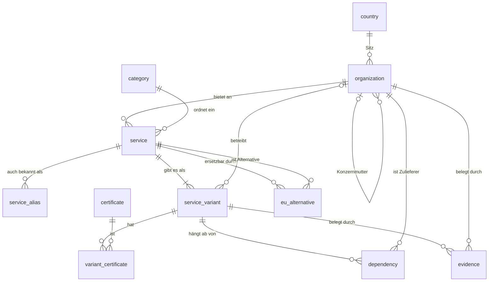

# Datenmodell der Anbieterdatenbank

Stand: Schritt 1.1, von Jonas am 13.10.2026 freigegeben.

## Grundsatz

Die Datenbank speichert **Fakten, keine Bewertungen**. Dort steht zum Beispiel „Mutterkonzern sitzt in den USA“ oder „Kunde kann eigene Schlüssel verwalten“, aber nicht „Stufe 1“. Die Stufe rechnet die Bewertungslogik in Phase 5 aus diesen Fakten aus.

Der Grund: Ändert sich unsere Auslegung der Stufen, passen wir eine Regel an und nicht 150 Einträge. Und jede Stufe lässt sich auf die Fakten zurückführen, aus denen sie entstanden ist.

## Überblick

Die Tabellen- und Feldnamen sind englisch, wie im Code üblich. Die Oberfläche und alle Texte für Nutzer bleiben deutsch.

## Die Tabellen

Umgesetzt in `backend/app/models/`, die Regeln sind in `backend/tests/test_models.py` als Tests festgehalten.

Jede Tabelle hat zusätzlich eine interne Nummer (`id`) sowie `created_at` und `updated_at`. Diese Felder sind unten weggelassen. Ausnahme ist `country`: Dort ist der Ländercode selbst der Schlüssel.

### `country` (Land)

| Feld | Bedeutung |
|---|---|
| `code` | Ländercode nach ISO 3166, z. B. `DE`, `US` |
| `name` | Name des Landes |
| `jurisdiction` | Rechtsraum: `EU_EWR`, `ANGEMESSEN` (Drittstaat mit Angemessenheitsbeschluss), `USA`, `DRITTSTAAT` |

Der Rechtsraum steht am Land und nicht am Unternehmen. Fällt ein Angemessenheitsbeschluss weg, ändern wir eine Zeile.

### `organization` (Unternehmen: Anbieter und Mutterkonzern)

| Feld | Bedeutung |
|---|---|
| `slug` | Lesbarer, fester Schlüssel, z. B. `microsoft` |
| `name` | Firmenname |
| `country_code` | Sitzland dieser Gesellschaft |
| `ultimate_parent_id` | Konzernmutter an der Spitze, leer bei eigenständigen Unternehmen |

Anbieter und Mutterkonzern liegen in **einer** Tabelle. Gespeichert wird nur die oberste Konzernmutter, nicht jede Zwischenstufe, weil sie den Rechtsraum bestimmt (CLOUD Act). Beispiel: LinkedIn Ireland hat Sitz in Irland, die Konzernmutter Microsoft sitzt in den USA, also gilt der Rechtsraum USA.

### `category` (Kategorie)

| Feld | Bedeutung |
|---|---|
| `slug`, `name` | z. B. `collaboration` / „Zusammenarbeit und Büro“ |

Rund 15 bis 20 Kategorien: Cloud-Infrastruktur, Büro und Zusammenarbeit, ERP, CRM, Personal, Videokonferenz, Identität, Sicherheit, Entwicklung, Analyse, KI und so weiter.

### `service` (Dienst)

| Feld | Bedeutung |
|---|---|
| `slug`, `name` | z. B. `microsoft-365` / „Microsoft 365“ |
| `provider_id` | Anbieter (Vertragspartner) |
| `category_id` | Kategorie |
| `description` | Ein Satz zum Zweck |
| `typical_criticality` | Übliche Kritikalität: `GERING`, `MITTEL`, `HOCH`. Vorbelegung, der Nutzer kann sie im Assessment ändern |

### `service_alias` (Andere Schreibweisen)

| Feld | Bedeutung |
|---|---|
| `service_id` | Zugehöriger Dienst |
| `alias` | z. B. „O365“, „Office 365“, „Teams“ |

Wird in Phase 2 für die Zuordnung von Freitext gebraucht. Die Schreibweisen fallen bei der Recherche in 1.4 ohnehin an, deshalb schon jetzt.

### `service_variant` (Bereitstellungsvariante)

Hier hängen alle Merkmale, die die Bewertung braucht. Jeder Dienst hat mindestens die Variante „Standard“.

| Feld | Bedeutung | Werte |
|---|---|---|
| `service_id`, `slug`, `name` | Dienst und Name der Variante | z. B. „Standard“, „EU Data Boundary“ |
| `is_default` | Variante, die der Schnellcheck annimmt | ja/nein |
| `operator_id` | Betreibergesellschaft, falls sie vom Anbieter abweicht | Unternehmen |
| `data_location` | Wo liegen die Daten? | `EU_ZUGESICHERT`, `EU_WAEHLBAR`, `NICHT_EU`, `UNBEKANNT` |
| `operations_location` | Von wo aus wird betrieben und Support geleistet? | `NUR_EU`, `EU_MIT_AUSNAHMEN`, `WELTWEIT`, `UNBEKANNT` |
| `transfer_basis` | Grundlage für Datenübermittlung in Drittstaaten | `NICHT_NOETIG`, `STANDARDVERTRAGSKLAUSELN`, `DATA_PRIVACY_FRAMEWORK`, `KEINE`, `UNBEKANNT` |
| `governing_law_country_code` | Vertragsrecht und Gerichtsstand | Ländercode |
| `key_management` | Wer hält die Schlüssel? | `ANBIETER`, `KUNDE_BEIM_ANBIETER` (BYOK), `KUNDE_EXTERN` (HYOK), `UNBEKANNT` |
| `data_export` | Kommen die Daten wieder heraus? | `OFFENE_FORMATE`, `PROPRIETAER`, `KEIN_EXPORT`, `UNBEKANNT` |
| `openness` | Technische Offenheit | `OPEN_SOURCE`, `OFFENE_STANDARDS`, `PROPRIETAER`, `UNBEKANNT` |
| `ai_training_on_customer_data` | Werden Kundendaten für KI-Training genutzt? | `NEIN`, `ABWAEHLBAR`, `JA`, `UNBEKANNT` |
| `renewable_energy` | Nachweis zu erneuerbarer Energie | `NACHGEWIESEN`, `ZUGESAGT`, `KEINE_ANGABE` |
| `review_status` | Prüfstand des Eintrags | `KI_VORSCHLAG`, `GEPRUEFT` |
| `reviewed_at` | Datum der Prüfung durch einen Menschen | Datum |

`UNBEKANNT` ist ein eigener Wert und kein leeres Feld. Die Bewertung behandelt ihn wie den ungünstigsten Fall und markiert ihn zur Prüfung. So kann fehlendes Wissen nie zu einer zu guten Stufe führen.

### `certificate` und `variant_certificate` (Zertifikate)

| Feld | Bedeutung |
|---|---|
| `certificate.slug`, `name`, `issuer` | z. B. `bsi-c5` / „BSI C5“ / „BSI“ |
| `variant_certificate.variant_id`, `certificate_id` | Welche Variante hat welches Zertifikat |
| `variant_certificate.valid_until` | Gültig bis, falls bekannt |

Zertifikate hängen an der Variante, weil sie oft nur für bestimmte Regionen oder Produktlinien gelten.

### `dependency` (Abhängigkeit in der Lieferkette)

| Feld | Bedeutung |
|---|---|
| `variant_id` | Abhängige Variante |
| `supplier_id` | Zulieferer (Unternehmen) |
| `kind` | `HOSTING`, `UNTERAUFTRAGNEHMER`, `TECHNOLOGIE`, `SUPPORT` |
| `is_critical` | Fällt der Dienst ohne diesen Zulieferer aus? |

Diese Tabelle unterscheidet Stufe 3 von Stufe 4: Ein EU-Anbieter, der auf einem US-Hyperscaler betrieben wird, ist nicht vollständig europäisch.

### `eu_alternative` (EU-Alternative)

| Feld | Bedeutung |
|---|---|
| `service_id` | Dienst, der ersetzt werden soll |
| `alternative_service_id` | Alternative, selbst ein Dienst in der Datenbank |
| `migration_effort` | Grober Aufwand: `GERING`, `MITTEL`, `HOCH` |
| `note` | Einschränkungen, z. B. „deckt nur E-Mail und Kalender ab“ |

Weil die Alternative selbst ein Dienst ist, wird sie mit derselben Logik bewertet. Die Roadmap kann dann zeigen, um wie viele Stufen sich ein Wechsel lohnt.

### `evidence` (Nachweis)

| Feld | Bedeutung |
|---|---|
| `variant_id` oder `organization_id` | Worauf sich der Nachweis bezieht (genau eines von beiden) |
| `attribute` | Welches Feld belegt wird, z. B. `data_location` |
| `source_url` | Quelle |
| `quote` | Fundstelle im Wortlaut oder Abschnitt |
| `retrieved_at` | Abrufdatum |

Setzt die Regel aus der CLAUDE.md um: jede Aussage mit Quelle, ein Mensch bestätigt. Dieselbe Tabelle nimmt in Phase 9 die Fundstellen aus Verträgen auf (Seitenangabe im Feld `quote`).

## Welches Feld speist welchen Zielbereich

| Zielbereich | Felder |
|---|---|
| Strategisch | Rechtsraum der Konzernmutter, `operator_id` |
| Rechtlich | Rechtsraum der Konzernmutter, `transfer_basis`, `governing_law_country_code` |
| Daten und KI | `data_location`, `key_management`, `ai_training_on_customer_data` |
| Operativ | `operations_location`, `data_export` |
| Lieferkette | `dependency` |
| Technologie | `openness`, `data_export` |
| Sicherheit und Compliance | Zertifikate |
| Umwelt | `renewable_energy` |

Strategisch, Operativ und Umwelt werden in Phase 5 zusätzlich durch Antworten aus dem Fragebogen ergänzt, etwa ob das Unternehmen eine Exit-Strategie hat.

### Probe: Reichen die Felder für unsere fünf Stufen?

| Stufe | Auslegung | Aus den Feldern ablesbar |
|---|---|---|
| 0 | Nicht-EU ohne Schutz | Konzernmutter außerhalb EU/EWR, sonst nichts erfüllt |
| 1 | Nicht-EU mit EU-Rechenzentrum und Standardvertragsklauseln | `data_location` in der EU, `transfer_basis` vorhanden |
| 2 | Nicht-EU mit EU-Betriebsgesellschaft, eigener Schlüsselverwaltung und Exit | `operator_id` mit Sitz in der EU, `key_management` beim Kunden, `data_export` möglich |
| 3 | EU-Anbieter mit einzelnen Nicht-EU-Abhängigkeiten | Konzernmutter in EU/EWR, mindestens eine `dependency` außerhalb |
| 4 | Vollständig EU | Konzernmutter in EU/EWR, keine `dependency` außerhalb |

Die genauen Regeln je Zielbereich entstehen in Schritt 5.1.

## Beispiel

Zur Veranschaulichung, die Angaben werden in Schritt 1.4 mit Quelle geprüft.

- **Dienst** „Microsoft 365“, Anbieter Microsoft Ireland Operations (IE), Konzernmutter Microsoft (US), Kategorie Büro und Zusammenarbeit
- **Variante „Standard“:** Daten in der EU wählbar, Schlüssel beim Anbieter
- **Variante „EU Data Boundary“:** Daten in der EU zugesichert, Betrieb in der EU mit Ausnahmen
- **Variante „Delos Cloud“:** Betreiber ist eine deutsche Gesellschaft, Microsoft bleibt als Technologie-Abhängigkeit eingetragen
- **Alternative:** ein europäisches Büropaket, Aufwand hoch

## Nicht Teil der Anbieterdatenbank

Diese Daten gehören zu einem einzelnen Assessment und kommen in späteren Phasen dazu. Sie verweisen auf `service_variant`:

- IT-Bestand eines Unternehmens und die Zuordnung zu Diensten (Phase 2)
- Erkennungsmerkmale für den Außenscan, etwa DNS-Muster (Phase 3)
- Fragebogen und Antworten (Phase 4)
- Vertragsdaten aus der KI-Analyse (Phase 9)

## Getroffene Entscheidungen

1. **Varianten sind eine eigene Tabelle.** Sonst lässt sich nicht abbilden, dass derselbe Dienst je nach Vertrag unterschiedlich abschneidet, und genau das ist der Hebel für Stufe 2.
2. **Nachweise stehen je Feld.** Pflicht sind sie für die Felder, die die Stufe bestimmen: Konzernmutter, Datenstandort, Schlüsselverwaltung, Zertifikate, Abhängigkeiten.
3. **Alternativen werden als Paare von Hand gepflegt.** „Gleiche Kategorie“ wäre automatisch, aber oft falsch.
4. **Alle Merkmale werden angelegt.** In 1.4 werden sie bei den ersten 20 Diensten vollständig gefüllt, danach wird entschieden, welche für die restlichen 130 Pflicht sind.

## Offen bis Schritt 5.1

Zählt ein Angebot mit EU-Betreiber und Nicht-EU-Technologie (Beispiel Delos Cloud) als Stufe 2 oder 3? Das Modell speichert die Fakten für beide Lesarten.
